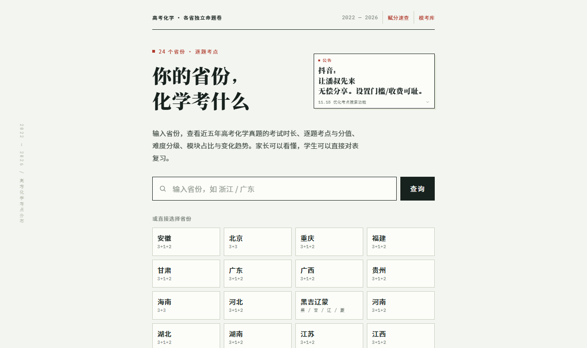

# 高考化学考点分布 · 各省独立命题卷（2022—2026）

一个纯静态的高考化学查询站点：选省份 → 看近五年真题的考试时长、逐题考点与分值、难度分级、模块占比与变化趋势；附带「再选科目赋分速查」和「模考库」两个子应用。

原站是托管在妙搭（Miaoda）上的交互式应用，本项目把它还原为**可独立部署的静态站点**：无构建步骤、无后端、无登录，双击 `index.html` 或用任意静态服务器即可打开。



## 功能

| 模块 | 说明 |
| --- | --- |
| 考点分布 | 24 个省级单位 · 2199 道题 · 2022—2026 五年逐题考点、分值、难度、模块占比 |
| 卷面档案 | 每年考试时长、满分、选择/非选择分值结构、省控线（本科线 / 特控线 / 211 线） |
| 考点搜索 | 按考点关键词跨省份检索（`js/core/kd-search.js`） |
| 原卷查看 | 题目级原卷截图 + 整页回退，答案解析可展开（`assets/qmap/qmap.js`） |
| PDF 导出 | 把当前省份的考点表绘制成 A4 PDF（jsPDF） |
| 赋分速查 | 29 个省级单位 · 8 套等级赋分规则，位次百分比 ↔ 赋分互查（`#fufen`） |
| 模考库 | 模拟卷索引与筛选（`#mock`） |

路由用 hash：`#省份名`、`#fufen`、`#mock`，所以部署到 GitHub Pages 不需要任何 rewrite 规则。

## 目录结构

```
.
├── index.html                 # 唯一页面（脚本按依赖顺序引入）
├── config.js                  # 站点配置：原卷索引地址、图片源开关
├── css/
│   ├── styles.css             # 主样式
│   ├── fufen.css              # 赋分速查
│   └── mockref.css            # 模考库
├── assets/
│   ├── data/exam-data.js      # 主数据：meta / modules / provinces / order / years
│   ├── qmap/qmap.js           # 题级原卷索引：省|年|场次|题号 → 图片路径、答案、飞书云文档
│   └── img/favicon.png
├── js/
│   ├── core/
│   │   ├── util.js            # 数据访问层 U：取题、统计、搜索、原卷索引
│   │   ├── views.js           # 共享视图片段（首页、省份页骨架）
│   │   ├── syn-groups.js      # 共用卷分组（黑吉辽蒙、陕晋青宁）
│   │   └── kd-search.js       # 考点搜索
│   ├── modules/
│   │   ├── cutoff.js          # 省控线
│   │   ├── fufen.js           # 赋分规则模型
│   │   └── mockref.js         # 模考卷索引
│   ├── views/
│   │   ├── fufen-view.js      # 赋分速查视图
│   │   └── mockref-view.js    # 模考库视图
│   ├── features/export-pdf.js # PDF 导出（canvas 绘制 → jsPDF）
│   ├── vendor/jspdf.umd.min.js
│   └── app.js                 # 入口：路由、渲染、原卷弹层
└── scripts/fetch_assets.py    # 批量下载原卷图片（可选，约 157 MB）
```

脚本之间靠全局对象通信（`window.EXAM_DATA` / `window.QMAP` / `window.U` / `window.App`），不是 ES Module，因此 `index.html` 中的引入顺序不能调换：`config → 数据 → 领域模块 → core → 子视图 → features → app`。

## 本地运行

任选一种：

```bash
python -m http.server 8000    # 然后打开 http://127.0.0.1:8000
npx serve .                   # 或者用 Node
```

直接双击 `index.html`（`file://`）也能跑，但个别浏览器会拦截本地资源，建议走 http。

## 部署到 GitHub Pages

1. 推送到 GitHub（默认分支 `main`）。
2. 仓库 **Settings → Pages** → Source 选 `Deploy from a branch` → 分支 `main` / 目录 `/ (root)`。
3. 等一两分钟，访问 `https://<用户名>.github.io/<仓库名>/`。

页面全部使用相对路径，不需要改任何配置即可在子路径下工作。

## 数据和原卷图片

- `assets/data/exam-data.js`（约 590 KB）：24 个省份的对象字典 + 11 个考点模块 + 年份索引，含每条题的考点、分值、难度、答案与核验状态（`〔待核〕` / `〔未检索到公开真题〕`）。
- `assets/qmap/qmap.js`（约 2.5 MB）：2199 条题级原卷索引，字段包括 `img`（整页图）、`imgQ`（单题精切图）、`imgA`（答案图）、`cloud`/`answerUrl`（飞书云文档原件）、`choice`（选择题答案）等。

**原卷图片默认不放在仓库里**（4471 个 webp，约 157 MB）。有两种用法：

1. **在线引用（默认）**：`config.js` 里 `window.ASSET_BASE` 指向原站，仓库保持 3 MB 左右，点开原卷时图片从原站加载。
2. **完全自托管**：

   ```bash
   python scripts/fetch_assets.py          # 断点续传，可重复执行
   ```

   下载到 `assets/y2426/` 之后，把 `config.js` 的 `window.ASSET_BASE` 改成 `""`。
   该目录默认在 `.gitignore` 里；要一起提交需要 `git add -f assets/y2426`（注意仓库体积）。

PDF 导出依赖 jsPDF：优先用本地 `js/vendor/jspdf.umd.min.js`，缺失时自动回退到 jsDelivr / unpkg CDN。

## 数据来源与声明

- 内容整理：抖音 **「让潘叔先来」**（波波老师），无偿分享；站点原文注明「设置门槛/收费可耻」。
- 数据来自教师整理的《各省高考化学独立卷真题考点分布》表格，并经真题逐题核对；标注〔待核〕的条目尚未取得原卷核验，仅供参考。难度分级为教学参考分级，非官方数据。
- 本项目是对原站点前端代码的**静态化重构**，不改变数据内容，也不声称拥有数据版权。数据版权归原作者，如有异议请联系删除。
- 代码部分以 MIT 许可发布（见 `LICENSE`），可自由用于自建镜像或二次开发。

## 免责声明

考试时长、分值、赋分规则均以各省考试院当年公开文件为准；本项目的整理结果与估算不构成报考建议。
